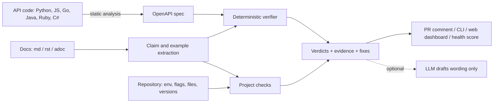

# Code-to-Docs - AI Documentation Assistant

[](https://github.com/marketplace/actions/upstream-docs-enhancer)
[](https://opensource.org/licenses/MIT)

[**Try the interactive demo**](https://redhat-community-ai-tools.github.io/code-to-docs/demo/)

AI-powered GitHub Action that automatically analyzes code changes and updates documentation using any OpenAI-compatible LLM (vLLM on OpenShift AI, Gemini, OpenAI, etc.).

## Usage

Comment on any Pull Request:
- **`[review-docs]`** - Analyzes code changes, identifies relevant doc files, and posts a review comment with checkboxes to accept or reject each suggestion
- **`[update-docs]`** - Creates a docs PR with only the accepted files from a previous review (or runs the full pipeline if no review exists)
- **`[review-feature] PROJ-123`** - Runs `[review-docs]` and adds a **Spec vs Code Analysis** section that fetches the Jira ticket and its linked spec docs (Confluence, Google Docs), compares requirements against the PR code changes, and identifies covered, missing, and unplanned changes
- **`[verify-docs]`** - Runs every deterministic check (API contract, code examples, env vars, CLI flags, file/function references, version claims) and posts one report with a combined health score. No LLM needed. See [Documentation Audit](#documentation-audit)
- **`[verify-api]`** - Checks the API documentation against your OpenAPI spec (no LLM needed) and posts a report where every check is **verified**, **contradicted** (with evidence from the spec) or **uncertain**. See [API Contract Verification](#api-contract-verification)

### Recommended Workflow

1. Comment `[review-docs]` to see which doc files the AI identified as needing updates
2. Uncheck any files you don't want updated
3. Comment `[update-docs]` to create a PR with only the checked files

You can guide how the AI generates doc updates by adding instructions in your `[update-docs]` comment. Lines matching `filename.ext: instruction` are per-file instructions; all other lines are global instructions passed to the LLM:

```
[update-docs] keep changes minimal, here are usage examples for context:

## Example usage
my-tool --flag value

config-ref.rst: only update the CLI usage example
```

## Persistent Style Guidelines

You can define repository-level documentation style rules that are automatically applied to every AI-generated update. Create the following file in your repository root:

- **`.code-to-docs/style.md`** — Freeform Markdown/prose, passed to the LLM as-is

The action auto-detects this file. To use a custom path instead, set the `style-config-path` action input.

**Example `.code-to-docs/style.md`:**
```markdown
# Documentation Style

- Use **active voice** and a professional tone
- Use sentence case for headings
- Use dashes for bullet lists
- Keep paragraphs short
- Use present tense
```

Per-comment instructions (`[update-docs] keep changes minimal`) continue to work alongside the persistent config, appearing as additional guidance after the style guidelines. If per-comment or per-file instructions contradict the style guidelines, the reviewer's instructions take precedence.

## Repository Configuration

You can configure code-to-docs behavior with a JSON config file in your repository root:

- **`.code-to-docs/config.json`** — Tool settings (loaded from the base branch, not the PR branch)

**Supported settings:**

| Key | Description | Example |
|-----|-------------|---------|
| `pr-title-prefix` | Prefix prepended to all PR titles and commit messages created by the tool | `":book:"` |

**Example `.code-to-docs/config.json`:**
```json
{
  "pr-title-prefix": ":book:"
}
```

With this config, generated PRs will be titled `:book: docs: update documentation from PR #123` instead of `docs: update documentation from PR #123`.

This file is optional — if missing, the tool uses default titles with no prefix.

## How It Works

1. **Triggered by PR Comments** - When someone comments `[review-docs]`, `[update-docs]`, or `[review-feature]` on a Pull Request
2. **Analyzes Code Changes** - Examines git diffs from your PRs using AI
3. **Smart File Selection** - Identifies relevant documentation files automatically
4. **Interactive Review** - Presents suggestions with checkboxes for user curation
5. **Content Generation** - Generates updated documentation in AsciiDoc, Markdown, or reStructuredText
6. **Spec vs Code Analysis** - Fetches Jira tickets and linked spec docs (Confluence, Google Docs) to identify gaps between requirements and the PR implementation

## Setup

### 1. Add Workflow

Create `.github/workflows/docs-assistant.yml`:

```yaml
name: Documentation Assistant

on:
  issue_comment:
    types: [created]

permissions:
  contents: write  # Required to push doc updates to PR branches
  issues: write
  pull-requests: write

jobs:
  docs-assistant:
    runs-on: ubuntu-latest
    if: |
      github.event.issue.pull_request && 
      contains(fromJSON('["OWNER","MEMBER","COLLABORATOR"]'), github.event.comment.author_association) &&
      (contains(github.event.comment.body, '[review-docs]') ||
       contains(github.event.comment.body, '[update-docs]') ||
       contains(github.event.comment.body, '[review-feature]') ||
       contains(github.event.comment.body, '[verify-api]') ||
       contains(github.event.comment.body, '[verify-docs]'))
    steps:
      - name: Get PR information
        id: pr_info
        if: github.event.issue.pull_request
        env:
          GH_TOKEN: ${{ secrets.GITHUB_TOKEN }}
        run: |
          PR_NUMBER=${{ github.event.issue.number }}
          echo "Extracting PR information for PR #$PR_NUMBER"
          PR_DATA=$(gh api repos/${{ github.repository }}/pulls/$PR_NUMBER)
          
          HEAD_REF=$(echo "$PR_DATA" | jq -r '.head.ref')
          HEAD_REPO=$(echo "$PR_DATA" | jq -r '.head.repo.full_name')
          BASE_REF=$(echo "$PR_DATA" | jq -r '.base.ref')
          
          echo "head_ref=$HEAD_REF" >> $GITHUB_OUTPUT
          echo "head_repo=$HEAD_REPO" >> $GITHUB_OUTPUT
          echo "base_ref=$BASE_REF" >> $GITHUB_OUTPUT
          echo "pr_number=$PR_NUMBER" >> $GITHUB_OUTPUT
          
          echo "PR info extracted: #$PR_NUMBER, base: $BASE_REF, head: $HEAD_REF"

      - name: Checkout PR Code
        uses: actions/checkout@v4
        with:
          repository: ${{ steps.pr_info.outputs.head_repo || github.repository }}
          ref: ${{ steps.pr_info.outputs.head_ref || github.ref }}
          fetch-depth: 0
          token: ${{ secrets.GITHUB_TOKEN }}

      - name: Rebind Origin to Main Repository
        env:
          GH_TOKEN: ${{ secrets.GITHUB_TOKEN }}
        run: |
          git remote set-url origin "https://github.com/${{ github.repository }}.git"
          git config --local http.https://github.com/.extraheader \
            "AUTHORIZATION: basic $(echo -n "x-access-token:${GH_TOKEN}" | base64 -w 0)"

      - name: Documentation Assistant
        uses: redhat-community-ai-tools/code-to-docs@v1
        with:
          model-api-base: ${{ secrets.MODEL_API_BASE }}
          model-api-key: ${{ secrets.MODEL_API_KEY }}
          model-name: ${{ secrets.MODEL_NAME }}
          docs-repo-url: ${{ secrets.DOCS_REPO_URL }}
          github-token: ${{ secrets.GITHUB_TOKEN }}  # For separate docs repos, use a PAT: ${{ secrets.GH_PAT }}
          pr-number: ${{ github.event.issue.number }}
          pr-base: origin/${{ steps.pr_info.outputs.base_ref || 'main' }}
          pr-head-sha: ${{ steps.pr_info.outputs.head_ref }}
          docs-subfolder: ${{ secrets.DOCS_SUBFOLDER }}
          comment-body: ${{ github.event.comment.body }}
          docs-base-branch: ${{ secrets.DOCS_BASE_BRANCH || 'main' }}
          jira-url: ${{ secrets.JIRA_URL }}
          jira-username: ${{ secrets.JIRA_USERNAME }}
          jira-api-token: ${{ secrets.JIRA_API_TOKEN }}
          google-sa-key: ${{ secrets.GOOGLE_SA_KEY }}
          max-context-chars: ${{ secrets.MAX_CONTEXT_CHARS }}
          style-config-path: '.code-to-docs/style.md'
```

### 2. Configure Secrets

Add these in **Settings → Secrets → Actions**:

| Secret | Description |
|--------|-------------|
| `MODEL_API_BASE` | Base URL of an OpenAI-compatible API (see examples below) |
| `MODEL_API_KEY` | API key for the model endpoint (leave empty if not required) |
| `MODEL_NAME` | Model name to use (e.g., `meta-llama/Llama-3.1-8B-Instruct`, `gemini-2.0-flash`) |
| `DOCS_REPO_URL` | Docs repository URL (e.g., `https://github.com/org/docs`) |
| `GH_PAT` | _(Optional)_ GitHub PAT with `repo` scope. Only needed for **separate docs repos** (`docs-repo-url` pointing to a different repo). For same-repo setups, the built-in `GITHUB_TOKEN` works — no PAT required. |
| `DOCS_SUBFOLDER` | _(Optional)_ Docs subfolder path (e.g., `docs`) |
| `DOCS_BASE_BRANCH` | _(Optional)_ Base branch for docs PRs (default: `main`) |
| `JIRA_URL` | _(Optional, for `[review-feature]`)_ Jira instance URL (e.g., `https://your-company.atlassian.net`) |
| `JIRA_USERNAME` | _(Optional, for `[review-feature]`)_ Jira username/email |
| `JIRA_API_TOKEN` | _(Optional, for `[review-feature]`)_ Jira API token ([create here](https://id.atlassian.com/manage-profile/security/api-tokens)) |
| `GOOGLE_SA_KEY` | _(Optional, for `[review-feature]`)_ Google service account JSON key for fetching Google Docs. Docs must be shared with the service account email. |
| `MAX_CONTEXT_CHARS` | _(Optional)_ Maximum characters for LLM prompt content (default: `400000`, ~100K tokens). Decrease for models with smaller context windows (e.g., `32000` for an 8K-token model). |

### 3. Optional Action Inputs

These are set as `with:` parameters in the workflow step (not as secrets):

| Input | Description |
|-------|-------------|
| `style-config-path` | _(Optional)_ Path to a Markdown style configuration file (`.md`) containing documentation style guidelines. If not set, auto-detects `.code-to-docs/style.md`. |

### Versioning

- `@v1` receives all backward-compatible updates (recommended)
- `@v1.1.2` pins to an exact release
- `@main` tracks unreleased changes and is not stable

### Supported Model Backends

Any OpenAI-compatible API works. Common examples:

| Backend | `MODEL_API_BASE` | `MODEL_NAME` |
|---------|-----------------|--------------|
| vLLM on OpenShift AI | `https://my-model-predictor-namespace.apps.cluster.example.com/v1` | Your InferenceService name (check `/v1/models`) |
| Gemini | `https://generativelanguage.googleapis.com/v1beta/openai/` | `gemini-2.0-flash` |
| OpenAI | `https://api.openai.com/v1` | `gpt-4o` |
| Ollama | `http://localhost:11434/v1` | `llama3.1` |

## Features

- 🤖 **AI-Powered Analysis** - Uses any OpenAI-compatible LLM to identify relevant docs
- 📝 **Smart Suggestions** - Only updates what's necessary
- 🔍 **Review Mode** - See changes before applying
- ⚡ **Auto-Update Mode** - Create PRs automatically
- 📚 **Format Support** - AsciiDoc, Markdown, and reStructuredText (.rst)
- 🚀 **Optimized Performance** - Semantic indexes and cached summaries reduce API calls
- 🔍 **Spec vs Code Analysis** - Compare PR changes against Jira spec docs to find covered, missing, and unplanned changes

## API Contract Verification

Comment `[verify-api]` on a PR to compare the documented API with its definition. The check is deterministic: no model is called, and your code is never executed.

- **Source of truth**: the `api-spec-path` input, an auto-detected `openapi.json` / `openapi.yaml` (repo root, `docs/`, `api/`), or, when there is no spec, the API code itself via `api-code-path`. Code is read statically (never run) for FastAPI, Flask, Django, Express, Go (gin, chi, echo, gorilla, net/http), Spring (Java/Kotlin), Rails and ASP.NET (controllers and minimal APIs). The Go, Spring, Rails and ASP.NET readers do not read parameter types or bodies, so a documented parameter the reader did not see is uncertain, not wrong. Anything that cannot be resolved statically (computed paths, unknown methods, unfollowed includes) is reported as uncertain, never guessed.
- **Docs**: Markdown, reStructuredText (`.rst`, including the `http` domain) and AsciiDoc (`.adoc`). Line numbers always point into the original file. Endpoints are recognized as `GET /users/{id}` in headings, tables, bullets or prose, with the parameter tables and status codes that follow.
- **Checks**: path and method exist; parameters exist with the same location, type and required flag (including request-body fields); response codes are defined.
- **Examples**: `curl`, `requests`/`httpx`, `fetch`/`axios` and raw HTTP examples are checked for path, method, query parameters and body fields. JSON sample responses are compared with the response schema (wrong types, unknown keys, missing required keys). Calls to other hosts are ignored.
- **Verdicts**: ✅ verified, ❌ contradicted (with evidence, a JSON pointer into the spec or a `file:line` in the code), ❓ uncertain. Each contradiction carries a suggested fix; add `--ai` to the comment to also get an AI-drafted rewrite, clearly labeled as AI-generated.
- **Health score**: 0-100 per file and overall, optionally tracked over time with a trend line (`--history`).

```bash
python src/api_contract.py --spec openapi.json docs README.md
python src/api_contract.py --code . docs            # read FastAPI/Flask/Django/Express/Go/Spring/Rails/ASP.NET code
python src/api_contract.py --app myproject.main:app docs   # imports and runs your FastAPI app
```

The exit code is `1` when something is contradicted, so it can also gate CI.

## Documentation Audit

`[verify-docs]` (or `python src/docaudit.py`) adds checks of what the docs say about the project itself, and merges everything into one report:

| Check | Docs claim | Compared with |
|---|---|---|
| Environment variables | ``export FOO=...``, "set `FOO`" | `os.environ`, `os.getenv`, `process.env`, `.env.example` |
| CLI flags | `--dry-run` | argparse, click, typer, commander |
| References | `src/app.py`, links, `build_order()` | files and function names in the repo |
| Versions | "Python 3.9+", "Node 18+" | `requires-python`, `engines.node` |
| Infrastructure | "listens on port 8080", `docker compose up web`, `--set image.tag=1`, `-var region=...` | Dockerfile `EXPOSE`, compose services and ports, Helm `values.yaml` keys, Terraform `variable` blocks |
| Anchor links | `[setup](setup.md#install)` | the headings of the target page (GitHub-style anchors) |
| Runbook commands | `make deploy`, `npm run build`, `./scripts/rotate.sh` | Makefile targets, `package.json` scripts, files in the repo |

A name that cannot be found is called contradicted only with real evidence (the code reads other variables, a near-identical spelling exists). Otherwise it is uncertain, because it may come from a dependency.

```bash
python src/docaudit.py docs README.md --code . --history .docaudit/history.json --fail-under 80
```

An infrastructure, link or runbook claim is only checked when the file it depends on exists, so a repository without Terraform is never told its docs are wrong about Terraform.

Exit codes: `0` ok, `1` something is contradicted (or the score is under `--fail-under`, or nothing could be checked while `--fail-under` is set), `2` a spec, code folder or app you named could not be read. A check that is skipped is never silently treated as a pass.

### Catch drift in pull requests

```bash
# only the docs a PR touches, plus docs that mention a code file it changed
python src/docaudit.py --changed-since origin/main

# adopt the tool on a project with old problems: only NEW contradictions fail
python src/docaudit.py --update-baseline        # writes .docaudit-baseline.json
python src/docaudit.py --fail-under 80          # known problems no longer fail the run

# findings in GitHub's Code Scanning tab
python src/docaudit.py --sarif docaudit.sarif
```

Findings in the baseline are matched by file, check, subject and message, not by line number, so editing the docs above a known problem does not make it look new. Deliberate exceptions go in `.docaudit.json`: `{"ignore": [{"file": "docs/legacy/*", "check": "reference"}]}`. In the GitHub Action set `DOCAUDIT_BASE_REF` to scope `[verify-docs]` to the changed files; both files are picked up from the repository root automatically.

### Breaking changes and deprecations

```bash
python src/api_diff.py v1.4.0 HEAD docs --fail-on-breaking     # two git refs
python src/docaudit.py --code . --compare-to origin/main docs   # inside the audit
```

The API at the older ref is unpacked with `git archive` into a temporary folder (your working tree is untouched) and compared with the newer one. Removed endpoints (with a "may have been renamed to" hint), newly required parameters, changed types and removed success responses are *breaking*; removed parameters, newly deprecated endpoints and other lost responses are worth a note. Each change lists the documentation lines that describe the affected endpoint. Separately, an endpoint the API marks `deprecated` whose docs never say so is reported as uncertain.

### Meeting notes

```bash
python src/docaudit.py docs --code . --meeting meetings/api-sync.vtt
python src/meeting_notes.py meeting.docx --root . docs           # on its own
```

Documentation mistakes often start in a meeting: "we're renaming `SHOP_DB_URL`", "the `/invoices` endpoint is retired", "the default limit goes from 20 to 50". The checker reads a Microsoft Teams transcript (`.vtt` or `.docx`) or plain `Speaker: text` notes, finds statements like these with fixed rules, and checks each against the code and docs:

- ✅ the code already matches and the docs agree
- ❌ the code matches the decision but the docs still describe the old thing
- ❓ the decision is not in the code yet (a *pending* item), or cannot be found

Output includes the speaker and timestamp as evidence, suggested edits, action items about documentation, and draft decision records. The transcript is read locally. With `--ai` a model may also *propose* decisions from loose conversation (speaker names and e-mail addresses are redacted first and a proposal must quote identifiers that really appear in the text), but the verdict always comes from searching the code. The dashboard has a **Meeting notes** tab; with only a spec and docs it can check endpoint decisions and says plainly that it cannot check files, variables or flags. `examples/shop-demo/meetings/api-sync.vtt` is a made-up meeting for the demo project.

### Collect Teams meetings and draft documentation updates

The **Meeting documentation drafts** workflow imports Microsoft 365 notes, extracts technical decisions, and checks them against the repository. Hourly and manual runs collect notes. Pushes to the default branch recheck saved decisions when code changes. The workflows stay idle until a repository administrator explicitly enables them.

| Source | What it collects |
| --- | --- |
| Teams, single meeting | Available transcripts for one Graph online meeting or recurring series. |
| Teams, organizer | Available transcripts from scheduled meetings organized by one user. |
| Teams, tenant | Enumerates enabled member users and polls up to 25 organizers per run, starting with the least recently attempted. The application access policy determines which organizers it can read. |
| OneDrive for Business | Direct children of one configured folder. Reads native `.loop` notes through Microsoft's HTML conversion, plus `.vtt`, `.docx`, `.txt` and `.md` exports. Can run alone or alongside Teams. |

Organizer and tenant discovery cover scheduled, non-channel meetings that have a transcript. Meetings without a transcript can contribute written notes saved in the selected folder. On the first pass, the collector requests available history. Later passes resume each organizer with a one-day overlap. A denied organizer keeps its previous transcript checkpoint for a future retry. [Microsoft Graph transcript discovery](https://learn.microsoft.com/en-us/graph/api/onlinemeeting-getalltranscripts?view=graph-rest-1.0) · [Loop HTML conversion](https://learn.microsoft.com/en-us/graph/api/driveitem-get-content-format?view=graph-rest-1.0)

**Try it locally.** Run from the project directory with Python 3.12 or newer. The first command imports the shop demo transcript, prints proposed line edits, and stores the decisions in a local database. The second rechecks them without reopening the transcript. Both commands leave the docs untouched.

```bash
python src/meeting_sync.py --root examples/shop-demo --docs docs --notes examples/shop-demo/meetings/api-sync.vtt --state ../shop-meeting-decisions.db
python src/meeting_sync.py --root examples/shop-demo --docs docs --state ../shop-meeting-decisions.db
```

**Connect a repository.** Install the workflow and the Python `src/` modules on the default branch of the repo containing the code and docs. For the loose Windows distribution, run `_protected_files/RESTORE.ps1` to place the workflows under `.github/workflows/`. In a bundle clone they are already there.

1. Register a Microsoft Entra application for the project. For Teams, grant the `OnlineMeetingTranscript.Read.All` application permission, administrator consent and an application access policy for the organizer. For OneDrive, grant read access to the selected library folder, for example through `Files.SelectedOperations.Selected` plus an explicit folder grant. Configure the permissions for the sources you use. [Teams transcript permissions](https://learn.microsoft.com/en-us/graph/api/onlinemeeting-list-transcripts?view=graph-rest-1.0) · [Organizer policy](https://learn.microsoft.com/en-us/graph/cloud-communication-online-meeting-application-access-policy) · [OneDrive selected permissions](https://learn.microsoft.com/en-us/graph/permissions-selected-overview)
2. In GitHub Actions, set repository variables `MS_TENANT_ID` and `MS_CLIENT_ID` and the repository **secret** `MS_CLIENT_SECRET`. Choose the source configuration below. Supply Graph resource IDs for the selected sources. [Look up a meeting by its join URL](https://learn.microsoft.com/en-us/graph/api/onlinemeeting-get?view=graph-rest-1.0) · [Address OneDrive items](https://learn.microsoft.com/en-us/graph/onedrive-addressing-driveitems)
   - For one meeting, set `TEAMS_ORGANIZER_ID` and `TEAMS_MEETING_ID`. The default `TEAMS_SCOPE` is `meeting`.
   - For one organizer, set `TEAMS_SCOPE=organizer` and `TEAMS_ORGANIZER_ID` (the user's object ID). Leave the meeting ID empty.
   - For tenant discovery, set `TEAMS_SCOPE=tenant` and leave both individual Teams IDs empty. Grant admin consent to the `User.Read.All` application permission for member discovery and assign the Teams application access policy to the intended organizers. [Directory user permissions](https://learn.microsoft.com/en-us/graph/api/user-list?view=graph-rest-1.0)
   - For a OneDrive folder, set `ONEDRIVE_DRIVE_ID` and `ONEDRIVE_FOLDER_ID`. For OneDrive alone, leave the Teams variables blank.
3. Set `MEETING_DOCS_PATH` to the guide or folder to edit (default `docs`) and `MEETING_CODE_PATH` to the implementation folder (default `.`). Optionally set `MEETING_SPEC_PATH` to a committed OpenAPI spec. All three paths are relative to the project root. Allow GitHub Actions to create pull requests in repository workflow settings. Set `MEETING_DOCS_ENABLED=true` and run **Meeting documentation drafts** from the Actions tab.

**What reviewers see.** When current code supports a decision, the workflow opens a draft PR with an edit, the repository evidence and a proposed release note. It can replace a renamed identifier, update an unambiguous documented value, or mark a removed Markdown endpoint heading as historical. A retry uses the same PR. Uncorroborated decisions stay pending. Ambiguous prose is flagged for manual review.

**Route reviews and disagreements.** A repository can add an optional `.code-to-docs/meeting-owners.json`. Use an exact file path, a folder prefix ending in `/`, or `*` for the fallback. Values are lists of GitHub users or organization teams with repository access. The most specific path wins for each document. For example:

```json
{
  "*": [],
  "docs/api/": ["@example-org/api-docs"],
  "docs/setup.md": ["@example-maintainer"]
}
```

Local preview prints matched owners. Publishing requests their review on the draft and checks the request history on retries. If notes disagree about one identifier, publishing opens one GitHub issue for that subject and base branch, lists the alternatives and mentions the matched owners. An empty owner map leaves the issue unassigned. Correct the notes, reimport them and close the issue when resolved. Closing an issue records the team's acknowledgement and suppresses further alerts in that thread. Publishing needs GitHub Issues enabled and permission to write issues and pull requests. [GitHub review requests](https://docs.github.com/en/rest/pulls/review-requests)

**Draft release notes.** The **Meeting release note draft** workflow writes Markdown to its Actions run summary for a version tag (`v*.*.*`) or a manual run. It includes same-repository meeting PRs merged into the selected base within the release's Git history. At least one other human must have approved the final PR head before merge, with no outstanding request for changes. The default range begins after the previous reachable version tag and includes the selected commit. The first release covers reachable history. A release manager can copy the draft into the changelog. To save it locally, run from a full checkout with a GitHub CLI login that can read the repository:

```bash
python src/meeting_release.py --repo OWNER/REPO --base main --from-ref v1.0.0 --to-ref v1.1.0 --output meeting-release.md
```

The optional `--state` argument supplies the original decision wording for older meeting PRs. A PR whose wording cannot be recovered still gets a generic entry and PR number.

**What is retained.** The runner reads the notes temporarily. The `meeting-docs-state` branch holds a SQLite database of technical identifiers, values, hashed source IDs and per-organizer sync timestamps keyed by hash. Repository readers can see these decisions, including pending changes. Use a repository whose audience can see that information. Reimporting an edited file refreshes its decisions. A source that expires or is removed leaves its previously imported decisions available for later code checks.

## Web Dashboard and Demo

```bash
python web/server.py     # then open http://127.0.0.1:8765
```

Paste a spec and docs (or select **Load the demo**) to see the documentation marked up line by line, with evidence and suggested fixes. It runs only on your machine (localhost), and nothing you paste is executed or uploaded.

`examples/shop-demo/` is a small FastAPI project whose docs contain 20 deliberately planted mistakes (API, environment, CLI, files, container, compose, Helm and Terraform); `EXPECTED_OUTPUT.md` is the report the checker produces for it, and a test keeps it current.

## Accuracy

`evaluation/` holds 24 hand-labeled cases (a project, its docs, and the verdict each claim must get). `python -m evaluation.run_eval` prints precision and recall per verdict, and `tests/test_eval.py` fails CI if they drop. The cases were written by the same team as the checker, so this is a regression gate, not an independent benchmark.



## Feature Review with [review-feature]

The `[review-feature]` command runs the full `[review-docs]` flow (identifying relevant doc files and suggesting updates) and adds a **Spec vs Code Analysis** section. It fetches the Jira ticket and its linked specification documents, extracts requirements, and compares them against the PR code changes to identify covered, missing, and unplanned changes.

[**See it in action**](https://redhat-community-ai-tools.github.io/code-to-docs/demo/review-feature)

### Spec Doc Locations

Spec docs can be linked from the Jira ticket description or comments. Supported formats:

- **Google Docs** — requires a Google service account key (`GOOGLE_SA_KEY` secret). Docs must be shared with the service account email.
- **Confluence** — fetched using the same Jira credentials (same Atlassian instance)

Links that cannot be fetched automatically will be flagged in the review for manual review.

### Important: Content Visibility

The `[review-feature]` comment includes content from the Jira ticket and linked spec documents (requirements, descriptions, analysis). This comment will be visible to anyone with access to the PR. Ensure that your repository's visibility settings are appropriate for the sensitivity of your Jira and spec doc content.

## Development

Requires Python 3.12+. Uses [uv](https://docs.astral.sh/uv/) for package management.

```bash
# Install dependencies (including dev tools)
uv sync --extra dev

# Run tests
uv run pytest -v

# Run tests with coverage
uv run pytest --cov=src --cov-report=term-missing

# Lint and format check
uv run ruff check src/ tests/
uv run ruff format --check src/ tests/

# Set up pre-commit hooks
uv run pre-commit install
```

CI enforces lint, format, and a 60% test coverage threshold on every PR.

## Performance Optimization

The action builds semantic indexes stored in `.doc-index/`:

- **Folder Indexes** — AI-generated summaries of each documentation folder, including per-file descriptions. The LLM selects relevant files directly from these descriptions without loading the actual file content, reducing API calls and runtime.

Indexes are automatically submitted via a PR to your main branch and shared across all PRs once merged, reducing runtime from ~20 minutes to ~4 minutes on large projects.

---

Built on [Code-to-Docs](https://github.com/redhat-community-ai-tools/code-to-docs) by Red Hat (MIT License).
